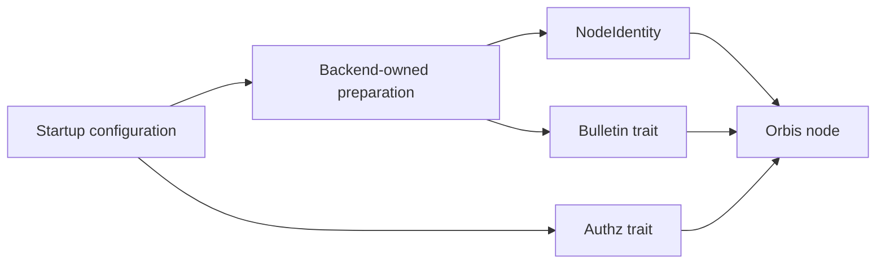

# Service boundaries and Docker E2E tests

The node composes independently selected bulletin and authorization services in
`runtime/backend.rs`. Bulletin implementations prepare identity and worker
storage, then expose `NodeIdentity` and `PreparedBulletin`. Authorization
implementations expose `Authz`. The running node receives trait objects;
protocol handlers do not select transports or manage Vera worker journals.



The DKG, PRE, signing, refresh, reshare, PET and reporting scenarios run through
`TestEnvironment`, implemented by the Vera adapter
(`bin/orbis-node/src/tests/e2e/vera_environment.rs`). The adapter owns certified
reads, state materialization and lifecycle operations; scenario assertions call
it rather than a Vera client.

`test-support` owns Docker orchestration. `VeraTestNetwork` starts four Vera
validators; the node test fixture adds three normal Orbis containers using
`ContainerNode`. Each container preserves its private store for restart checks.
No test-only runtime is added to the production binary.

Run the E2E suite:

```sh
scripts/test-e2e.sh --crypto bls12-381
```

The in-process fault-injection scenarios (`tests::e2e::fault_injection`) start a
`verad` cluster without Docker. They are ignored by default; run them with a
built `verad`:

```sh
VERAD_BINARY=/path/to/verad cargo test -p orbis-node --lib --no-default-features \
  --features integration-test,vera,test-support/vera,redb,iroh,bls12-381,fault-injection \
  tests::e2e::fault_injection -- --ignored --test-threads=1
```

For Jubjub, change `--crypto` and the Orbis image together. Use normal images,
without storage KDF or deadline overrides. The Vera fixture provisions valid
policy and ring state through Vera and keeps the normal PSS interval of 86400.

The [hosted gateway qualification](vera-trust-hosted.md) uses the same Docker
lifecycle for the separate Go Trust service, including executable and container
packaging. It does not invoke every existing integration test.

### Trust-owned ring qualification

The hosted driver accepts `build --local-image` when the workflow runs in Trust's
repository. BuildKit loads the unchanged gateway image locally, and the transfer
archive includes that image with its SHA-256 alongside the normal executable,
verifier and compiled Go fixture. Neither the gateway image nor its build cache
is published. Restore rejects missing, extra or changed image evidence and checks
the loaded image's immutable ID before executing either fixture mode.

The run phase also accepts already-loaded immutable image IDs for the Vera
node and chain images. Registry references retain the existing pull path. Source,
curve, backend, production-feature labels and gateway/verifier binary equality
remain required in both paths. The existing two-mode test and deadlines are
unchanged; transport preparation alone does not establish a passed DKG run.
